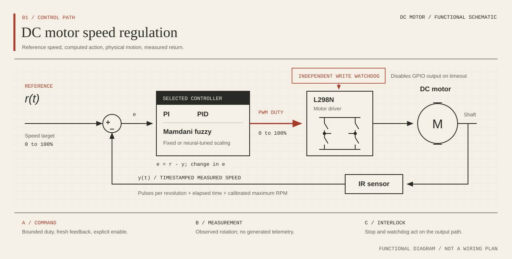
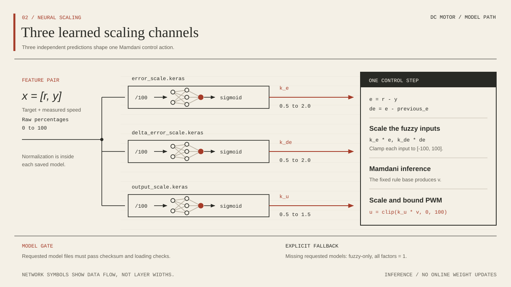
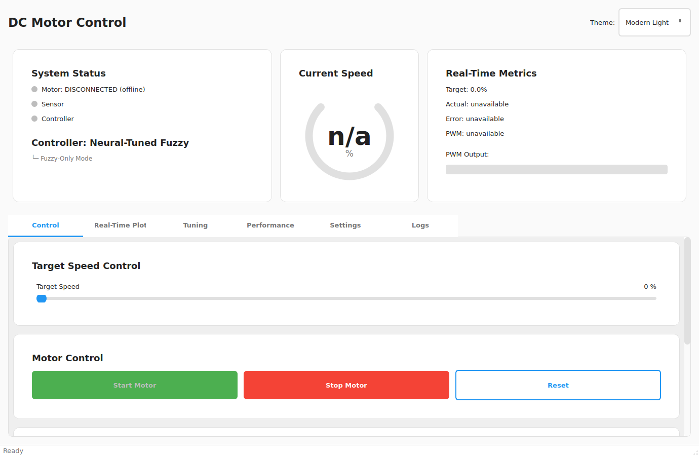

# Neuro-Fuzzy DC Motor Control

[](https://github.com/alexhaya4/dc-motor-neuro-fuzzy/actions/workflows/security-audit.yml)
[](#quick-start)
[](LICENSE)
[](https://doi.org/10.5281/zenodo.20124685)

A Python control-engineering workbench for studying DC motor speed regulation on a Raspberry Pi. Compare PI, PID, Mamdani fuzzy logic and neural-tuned fuzzy control through a PyQt5 interface, using measured speed feedback and explicit PWM commands.

Built by [Alex Odhiambo Haya](https://github.com/alexhaya4). The accompanying [research preprint](https://doi.org/10.5281/zenodo.20124685) explains the educational platform and its controller architecture.

[Quick start](#quick-start) · [Hardware setup](docs/USAGE.md#raspberry-pi-setup) · [Training](docs/USAGE.md#collect-data-and-train) · [Contributing](CONTRIBUTING.md) · [Citation](#research-and-citation) · [Licensing](#licensing)

## What it does

| Controller | Implementation | Use |
| --- | --- | --- |
| PI | Proportional and integral feedback | Establish a conventional baseline. |
| PID | Proportional, integral and derivative feedback | Study transient response and tuning. |
| Fuzzy | Mamdani inference over error and change in error | Explore rule-based nonlinear control. |
| Neural-tuned fuzzy | Three Keras networks adjust fuzzy input and output scaling | Study learned scaling alongside the fixed fuzzy baseline. |

The maintained launcher displays speed, error, PWM output and available performance metrics. It supports controller switching, configuration and logging. Collection and relay-tuning commands use the hardware path directly.

**Current status:** software checks cover the control loop, model training, model loading, GPIO protocol handling and offline interface startup. Physical motor validation and quantitative controller comparisons remain outstanding for this maintenance revision. No controller is presented as the measured best performer.

## Inside the feedback loop



*Figure 1. The command travels forward; the shaft measurement closes the feedback loop. Functional connections are shown, not electrical wiring.*

The sensor worker converts debounced pulses into speed using elapsed time and configured pulses per revolution. Control calculations use timestamped feedback. The output path rejects stale results, while a separate write watchdog disables PWM if control writes stop.

For neural tuning, the networks predict scaling factors from target and measured speed. The fuzzy rule base still computes the control action:



*Figure 2. The three learned factors change the scale of the fuzzy inputs and output. Network symbols describe the data path, not exact layer widths.*

Without a complete set of requested, checksum-verified models, the application reports **fuzzy-only mode**. Neural scaling factors are bounded, and invalid controller output is rejected.

## Interface



*Actual offline interface. No GPIO is opened, no speed readings are generated, and motor start is disabled. The fuzzy-only indicator shows that trained models are absent.*

## Quick start

Use **Python 3.11 or 3.12 on a 64-bit system**. The desktop interface needs a graphical session; Linux and WSL with WSLg are suitable environments for inspection.

```bash
git clone https://github.com/alexhaya4/dc-motor-neuro-fuzzy.git
cd dc-motor-neuro-fuzzy
./install.sh
./run.sh --offline
```

If your default Python differs, select a supported interpreter explicitly:

```bash
PYTHON=python3.12 ./install.sh
```

To operate a connected motor, follow the [Raspberry Pi setup](docs/USAGE.md#raspberry-pi-setup). The maintained GPIO backend targets Raspberry Pi 3/4 with 64-bit Raspberry Pi OS and Python 3.11 or 3.12. Raspberry Pi 5 support is not established.

## Data collection and training

After configuring and checking the physical rig:

```bash
.venv/bin/python improved_data_collection.py
.venv/bin/python train_networks.py --data data/training_data.json --models models
```

The collector writes measured feedback and **heuristic scaling-factor labels** in the trainer's schema. Those labels are not experimentally optimized gains. The relay-tuning command produces candidate PI/PID gains separately; it does not supply validated neural training targets.

Training produces `error_scale.keras`, `delta_error_scale.keras` and `output_scale.keras`, each with a SHA-256 sidecar. Normalization is embedded in newly trained models. Only load trusted model files: a checksum detects file changes and does not establish who created a model.

See [collection, training and relay tuning](docs/USAGE.md#collect-data-and-train) for the operational details and compatibility notes.

## Validation and limits

| Area | Evidence provided | Still required |
| --- | --- | --- |
| Controller logic | Regression tests for bounds, zero targets and controller behavior | Measurements across motor speeds and loads |
| Runtime and GPIO | Test adapters exercise stale feedback, output races, watchdogs and shutdown | Physical sensor, PWM and disconnect checks |
| Neural models | Actual TensorFlow training and save/load tests | Evaluation on separate recording sessions |
| Interface | Offline Qt startup and plotting checks | Inspection on the target Pi display |
| Dependencies | Hash-locked installs on Python 3.11/3.12, vulnerability audits and CodeQL | Continued dependency and platform maintenance |

Stop, stale feedback, controller replacement and shutdown disable commanded output. The independent watchdog is software protection, not a hardware emergency stop or a real-time guarantee. Provide a physical power disconnect and validate the driver, supply and sensor voltage before running a motor.

Metrics report missing observations as unavailable. Settling requires a continuous observed in-band tail; a single threshold crossing does not establish settling.

## Project guide

| Location | Responsibility |
| --- | --- |
| [`modern_motor_gui.py`](modern_motor_gui.py) | Maintained application entry point |
| [`control_runtime.py`](control_runtime.py), [`motor_hardware.py`](motor_hardware.py) | Timestamped control, sensor feedback and GPIO output |
| [`base_controller.py`](base_controller.py), [`conventional_controllers.py`](conventional_controllers.py), [`neural_tuned_fuzzy_controller.py`](neural_tuned_fuzzy_controller.py) | Controller implementations |
| [`nn_models.py`](nn_models.py), [`train_networks.py`](train_networks.py) | Scaling networks, training and model persistence |
| [`improved_data_collection.py`](improved_data_collection.py), [`auto_tuner.py`](auto_tuner.py) | Hardware collection and candidate relay tuning |
| [`performance_metrics.py`](performance_metrics.py), [`tests/`](tests/) | Observation-based metrics and software verification |

The older launcher, collection and controller import names remain small compatibility adapters. Operating instructions live in the [usage guide](docs/USAGE.md); development checks live in [CONTRIBUTING.md](CONTRIBUTING.md). See the [changelog](CHANGELOG.md) for changes.

## Development

```bash
.venv/bin/python -m pip install --require-hashes -r requirements-dev.txt
.venv/bin/python -m pytest
.venv/bin/python -m ruff check --select E9,F .
```

CI tests Python 3.11 and 3.12, audits runtime and Pi dependency locks, and runs CodeQL. Failures fail the workflow. See [CONTRIBUTING.md](CONTRIBUTING.md) for dependency updates, checks and hardware-test boundaries. Report vulnerabilities through the process in [SECURITY.md](SECURITY.md).

## Research and citation

**Alex Odhiambo Haya.** *A Neural-Tuned Fuzzy Controller for DC Motor Speed Regulation: An Open-Source Educational Platform on Raspberry Pi.* Zenodo preprint, version 1.0.0, 11 May 2026. [doi:10.5281/zenodo.20124685](https://doi.org/10.5281/zenodo.20124685).

The archived preprint describes the earlier platform. This repository's maintained code has since changed; the archived paper does not certify the current revision or establish comparative performance. Cite the paper for the research description and record the exact Git commit used in an experiment.

<details>
<summary>BibTeX</summary>

```bibtex
@misc{haya2026neuralfuzzy,
  author       = {Haya, Alex Odhiambo},
  title        = {A Neural-Tuned Fuzzy Controller for DC Motor Speed Regulation:
                  An Open-Source Educational Platform on Raspberry Pi},
  year         = {2026},
  month        = may,
  publisher    = {Zenodo},
  version      = {1.0.0},
  doi          = {10.5281/zenodo.20124685},
  url          = {https://doi.org/10.5281/zenodo.20124685},
  note         = {Preprint}
}
```

</details>

GitHub's **Cite this repository** action uses [`CITATION.cff`](CITATION.cff).

## Licensing

| Material | Terms |
| --- | --- |
| Original repository code, documentation and new README media | [MIT](LICENSE); retain the copyright and permission notice when redistributing |
| The linked Zenodo preprint, including its figures | [CC BY 4.0](LICENSES/CC-BY-4.0.txt), as declared by the [publication record](https://zenodo.org/records/20124685); attribute the author, identify the source, link the license and indicate changes |
| Third-party packages and bundled components | Their respective upstream licenses; see [third-party notices](THIRD_PARTY_NOTICES.md) |

The paper is linked from Zenodo rather than copied into the repository. PyQt5 is offered under GPLv3 or a Riverbank commercial license; the repository's MIT license does not replace the terms of dependencies. See the [license scope](LICENSES/README.md) before redistributing a packaged application.
